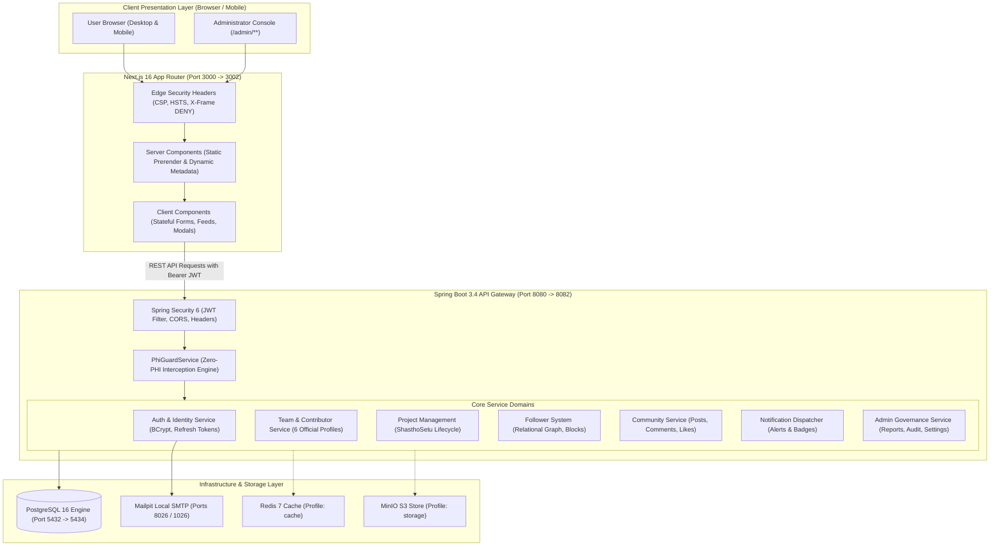

# MediNex System Architecture & Design Specification

## 1. Architectural Philosophy & Context

MediNex is a collaborative healthcare innovation and technology platform connecting software engineers, researchers, and public health professionals (originally incubated during E-Health Hackathon 2026).

The platform is designed around two foundational architectural pillars:
1. **The MediNex Public Community Platform:** An open collaboration ecosystem featuring contributor profiles, official announcements, public project specifications, follower relationships, and healthcare technology discussion feeds without fabricating credentials, followers, or clinical metrics.
2. **The ShasthoSetu Health Record Exchange Initiative:** An interoperable digital health record and exchange prototype exploring standardized HL7 FHIR resource alignment, patient consent workflows, RBAC, and identity mapping concepts, strictly decoupled from the public social network.

---

## 2. High-Level Architecture Diagram

---

## 3. Technology Stack Justification

| Tier | Technology | Justification & Architectural Role |
| :--- | :--- | :--- |
| **Frontend** | Next.js 16 App Router, React 19, TypeScript | Server Components for instant paint, SEO dynamic metadata, and strict type safety |
| **Styling** | Tailwind CSS | Strict utility tokens adhering to the HYBRID palette (`#071A18`, `#063D38`, `#0D9488`, `#5EEAD4`, `#F7FAF9`) |
| **Animation & UI** | Framer Motion, Lucide-React | Smooth accessible interactions with reduced motion respect |
| **Backend** | Spring Boot 3.4.3 (Java 21 LTS) | Enterprise type-safety, declarative transaction management, Actuator observability |
| **Security** | Spring Security 6 & JJWT | Stateless JWT with rotating refresh tokens, HttpOnly cookie support, and BCrypt (work factor 12) |
| **Database** | PostgreSQL 16 + Flyway | ACID transactions, UUID primary keys, JSONB support for dynamic specs, deterministic schema migrations |
| **DevOps** | Multi-Stage Dockerfiles & Compose | Isolated internal bridge network, non-root users (`10001`), healthy service dependency orchestration |

---

## 4. Strict Healthcare Data Segregation Principle

```mermaid
flowchart LR
    subgraph PublicDomain ["Public Community Network"]
        direction TB
        A["Registered Community Users"]
        B["Public Posts & Discussions"]
        C["Relational Follower Graph"]
        D["Social Reactions (Likes/Comments)"]
    end

    subgraph IsolationBarrier ["Zero-PHI Enforcement Barrier"]
        direction TB
        E["PhiGuardService Regex Scanners"]
        F["Strict 400 Bad Request Rejection"]
        G["Separate Token Authority"]
        H["Zero Clinical Tables in Public DB"]
    end

    subgraph InteropDomain ["ShasthoSetu Research Sandbox"]
        direction TB
        I["HL7 FHIR Schema Research"]
        J["Consent & RBAC Exchange Concept"]
        K["Synthetic Non-PHI Test Fixtures"]
    end

    PublicDomain -->|Intercepted by| IsolationBarrier
    IsolationBarrier -.->|BLOCKED / FORBIDDEN| InteropDomain
```

1. **Zero Protected Health Information (PHI):** The public database never stores patient names, health insurance numbers, hospital case IDs, diagnoses, or prescriptions.
2. **Distinct Token Scopes:** Community access tokens generated by MediNex grant zero privilege to clinical health-record APIs.
3. **Transparent Placeholders:** Team contributor credentials and project achievements are explicitly marked as placeholders until verified by the six team members.

---

## 5. Subsystem Component Architecture

### 1. Identity, Authentication & Session Layer
- **BCrypt Hashing:** Passwords hashed with cost factor 12.
- **Dual-Token Strategy:** Stateless 15-minute access tokens + 7-day rotating refresh tokens.
- **Replay Attack Detection:** Expired or revoked refresh tokens trigger immediate invalidation.

### 2. Follower & Relational Graph Architecture
- **Dedicated Tables:** `team_follows` and `user_follows` maintain isolated follow semantics.
- **Integrity Constraints:** Prevents self-follow (`follower_id <> following_id`) and duplicate follows via unique composite constraints.
- **Private Profiles:** Follow requests enter `follow_requests` queue until accepted or rejected.
- **Private Profiles & Feed Isolation (`ProfileAccessGuard`):** Enforces `isPublicVisible = false` (`403 Forbidden`) and mutual block exclusion consistently across profiles, follower/following lists, team member lookups, community feeds (`PostRepository.findFeedPosts`), post threads, comments, likes, and user post tabs.
- **Mutual Blocks:** `blocks` table strictly isolates interaction and prevents feed exposure.

### 3. Community Feed & Moderation Architecture
- **Multi-Resolution Avatars & WebP Support:** User avatar uploads validate JPEG, PNG, and pure-Java WebP (`imageio-webp:3.13.1`) streams, center-crop, strip metadata, and store 64px (`-sm`), 256px (`-md`), and 512px (`-lg`) JPEGs on the persistent `medinex_uploads` volume (`/app/uploads`).
- **Multi-Attachment Engine:** Posts support up to 4 image attachments with validated MIME types.
- **Hierarchical Discussions:** Self-referencing `parent_comment_id` supports nested discussion trees.
- **Atomic Reactions:** `post_likes` and `comment_likes` use unique constraints preventing duplicate likes.
- **Moderation Workflow:** Reports flow into the admin queue for triaged review (`HIDE_POST`, `HIDE_COMMENT`, `SUSPEND_USER`).

### 4. Zero-PHI Detection Engine
- Intercepts submissions containing clinical keywords (`MRN:`, `Hospital ID:`, `Rx:`, `Chief Complaint:`, `ICD-10:`, `Patient Name:`).
- Immediately aborts transaction and returns `400 Bad Request` with an explanatory error envelope.

---

## 6. Performance & Scalability Strategy

- **Partial Indexing:** High-frequency community feed queries hit the partial index `idx_posts_public_feed` (`WHERE is_hidden = FALSE AND deleted_at IS NULL AND visibility = 'PUBLIC'`).
- **Composite Traversal Indexes:** Follower counts and nested comments leverage composite indexes to prevent sequential scans.
- **Image Optimization:** Modern image formats (`avif`, `webp`) served with automated dimension constraints.
- **Stateless Horizontal Scaling:** Spring Boot API instances operate completely stateless, allowing seamless scale-out behind load balancers.
