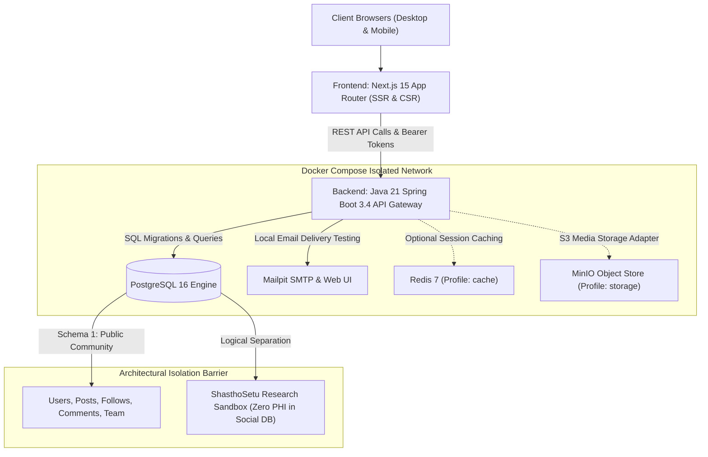
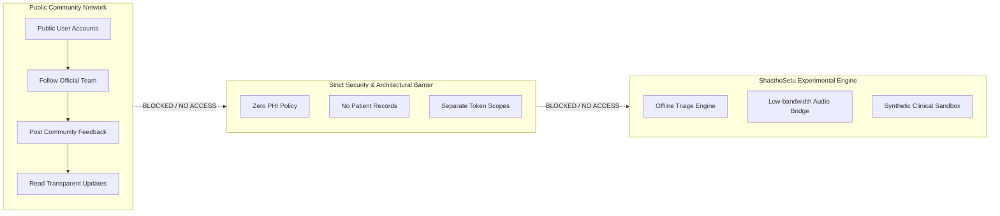

# MediNex System Architecture & Design Specification

## 1. Architectural Philosophy & Context

MediNex is a production-oriented healthcare innovation and community collaboration platform engineered for an interdisciplinary team of six contributors participating in **E-Health Hackathon 2026**.

The system addresses two interconnected objectives:
1. **Public Collaboration & Verification Hub:** An open, transparent community ecosystem that enables peer review, public following, discussion feeds, and official team disclosures without fabricating user metrics or clinical certifications.
2. **Telemedicine Connectivity Prototyping (ShasthoSetu):** An edge-resilient digital triage bridge for underserved community clinics, strictly decoupled from the public social network.

---

## 2. High-Level Architecture Diagram

---

## 3. Technology Stack Justification

| Tier | Technology | Justification |
| :--- | :--- | :--- |
| **Frontend** | Next.js 15 App Router, React 19, TypeScript | Server Components for instant initial paint, SEO metadata, accessible UI rendering |
| **Styling** | Tailwind CSS | Strict utility tokens adhering to the HYBRID palette (#071A18, #063D38, #0D9488, #5EEAD4, #F7FAF9) |
| **Icons & State** | Lucide-React, React Hook Form, Zod | Type-safe form validation and accessible SVG icons |
| **Backend** | Spring Boot 3.4 (Java 21 LTS) | Enterprise type-safety, declarative transaction management, Actuator observability |
| **Security** | Spring Security 6 & JJWT | Stateless JWT with rotating refresh tokens, HttpOnly cookie support, and BCrypt (cost factor 12) |
| **Database** | PostgreSQL 16 + Flyway | ACID transactions, UUID primary keys, JSONB support for dynamic specs, deterministic schema migrations |
| **DevOps** | Multi-Stage Dockerfiles & Compose | Isolated internal bridge network, non-root users (`10001`), healthy service dependency orchestration |

---

## 4. Strict Healthcare Data Segregation Principle

1. **Zero Protected Health Information (PHI):** The public database never stores patient names, health insurance numbers, hospital case IDs, diagnoses, or prescriptions.
2. **Distinct Token Scopes:** Community access tokens generated by MediNex grant zero privilege to clinical triage APIs.
3. **Transparent Placeholders:** Team contributor credentials and project achievements are explicitly marked as placeholders until verified by the six team members.

---

## 5. Security & DevSecOps Strategy

- **Non-Root Execution:** Both frontend (`nextjs:10001`) and backend (`appuser:10001`) run in unprivileged containers.
- **Layered Docker Builds:** Dependency steps are cached independently from source code compilation.
- **CORS Allowlist:** Restricted to configured domains (`http://localhost:3000`, `http://127.0.0.1:3000`).
- **Parameterized SQL:** All database interactions utilize JPA/Hibernate parameterization, eliminating SQL injection vectors.
- **Audit Logging:** Every critical administrative action is immutably recorded in the `audit_logs` table with actor, IP, timestamp, and metadata.
