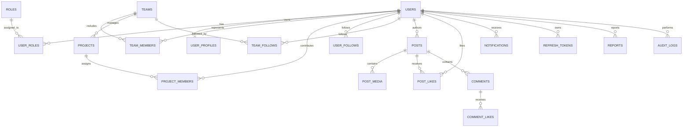

# MediNex Database Schema Documentation

## Overview

The MediNex database architecture is engineered on **PostgreSQL 16+** with **Flyway** migration management. The relational model is organized around three strict boundaries:

1. **Authentication, RBAC & Security Tokens** (users, roles, tokens, audit logs)
2. **Team & Official Initiatives** (teams, 6-member contributors, projects, ShasthoSetu)
3. **Public Community Social Graph** (posts, comments, likes, notifications, follower tables)

> [!IMPORTANT]
> **Strict Healthcare Data Isolation:**
> MediNex does **NOT** store patient medical records, personal health identifiers (PHI), clinical diagnoses, or clinical images on the community platform. ShasthoSetu is an isolated experimental telemedicine bridge whose clinical triage encounters remain separated.

---

## Entity-Relationship Diagram (ERD)



---

## Relational Tables Specification

### 1. Security & Identity Tables

| Table | Primary Key | Description | Key Constraints |
| :--- | :--- | :--- | :--- |
| `users` | `id` (UUID) | System user identity | `UNIQUE(username)`, `UNIQUE(email)`, `chk_users_status` |
| `roles` | `id` (VARCHAR) | RBAC role definitions | `ROLE_SUPER_ADMIN`, `ROLE_ADMIN`, `ROLE_MODERATOR`, `ROLE_USER` |
| `user_roles` | `(user_id, role_id)` | Composite mapping | Foreign keys with `ON DELETE CASCADE` |
| `refresh_tokens` | `id` (UUID) | Rotating JWT refresh tokens | `UNIQUE(token_hash)`, `expires_at`, `revoked` flag |
| `email_verification_tokens` | `id` (UUID) | One-time email tokens | Expiring token hash |
| `password_reset_tokens` | `id` (UUID) | Expiring reset credentials | One-time usage constraint |

### 2. Contributor & Team Tables

| Table | Primary Key | Description | Key Constraints |
| :--- | :--- | :--- | :--- |
| `teams` | `id` (UUID) | Official MediNex team entity | `UNIQUE(slug)`, `tagline`, `mission_statement` |
| `team_members` | `id` (UUID) | 6 Core contributors | `UNIQUE(team_id, user_id)`, `display_order`, `is_placeholder` |
| `user_profiles` | `id` (UUID) | Public profiles | Verified credentials, skills array, social links |
| `projects` | `id` (UUID) | Official projects (ShasthoSetu) | `UNIQUE(slug)`, `stage` check constraint |
| `project_members` | `id` (UUID) | Project assignments | `UNIQUE(project_id, user_id)` |

### 3. Follower & Social Graph Tables

| Table | Primary Key | Description | Key Constraints |
| :--- | :--- | :--- | :--- |
| `user_follows` | `id` (UUID) | User-to-user follows | `UNIQUE(follower_id, following_id)`, self-follow check |
| `team_follows` | `id` (UUID) | User-to-team follows | `UNIQUE(follower_id, team_id)` |
| `follow_requests` | `id` (UUID) | Private account requests | `status IN ('PENDING','ACCEPTED','REJECTED')` |
| `blocks` | `id` (UUID) | Account blocking | Prevents interaction and feed exposure |

### 4. Community Feed & Moderation Tables

| Table | Primary Key | Description | Key Constraints |
| :--- | :--- | :--- | :--- |
| `posts` | `id` (UUID) | Community posts | `visibility IN ('PUBLIC', 'MEMBERS_ONLY', 'PRIVATE')` |
| `post_media` | `id` (UUID) | Image attachments | Validated mime type, file size bytes |
| `post_likes` | `id` (UUID) | Post likes | `UNIQUE(post_id, user_id)` (prevents duplicate likes) |
| `comments` | `id` (UUID) | Hierarchical comments | Self-referencing `parent_comment_id` |
| `comment_likes` | `id` (UUID) | Comment likes | `UNIQUE(comment_id, user_id)` |
| `notifications` | `id` (UUID) | User alerts | Index on `(recipient_id, is_read, created_at DESC)` |
| `reports` | `id` (UUID) | Moderation reports | `status IN ('PENDING', 'UNDER_REVIEW', 'RESOLVED', 'DISMISSED')` |
| `audit_logs` | `id` (UUID) | Immutable audit trail | Actor, action, IP, target entity, JSONB details |

---

## Flyway Migration Management

Migrations are located in `backend/src/main/resources/db/migration/`:
- `V1__init_schema.sql`: Full baseline schema.

### Execution Commands
- Flyway executes automatically on Spring Boot application startup when `spring.flyway.enabled=true`.
- To verify migration state manually using Maven:
  ```bash
  mvn flyway:info
  mvn flyway:migrate
  ```
