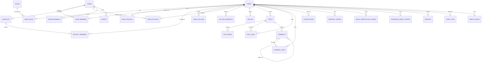

# MediNex Database Schema & Relational Architecture

## Overview

The MediNex database architecture is engineered on **PostgreSQL 16+** and governed deterministically using **Flyway** schema migrations. All primary keys utilize RFC 4122 UUID v4 identifiers, timestamps are stored in UTC with timezone (`TIMESTAMP WITH TIME ZONE`), and relational integrity is strictly maintained through foreign keys, check constraints, and non-nullable invariants.

> [!IMPORTANT]
> **Cardinal Healthcare Data Isolation Rule:**
> MediNex does **NOT** accept, index, or persist patient medical records, personal clinical health information (PHI), clinical diagnostics, or hospital records in any public community database table. ShasthoSetu is an isolated engineering initiative whose telemedicine encounters remain separated from community interactions.

---

## Entity-Relationship Diagram (ERD)

---

## Database Migration Lifecycle (Flyway)

Migrations reside in `backend/src/main/resources/db/migration/`:

### 1. `V1__init_schema.sql` (Baseline Schema)
Creates all 26 core tables, primary UUID extensions (`uuid-ossp`, `pgcrypto`), foreign keys with cascade policies, check constraints, default roles (`ROLE_SUPER_ADMIN`, `ROLE_ADMIN`, `ROLE_MODERATOR`, `ROLE_USER`), and baseline indexes.

### 2. `V2__performance_indexes.sql` (Performance Hardening)
Adds production indexing optimizations targeting high-throughput queries:
- **`idx_posts_public_feed`:** Partial index on `posts (created_at DESC) WHERE is_hidden = FALSE AND deleted_at IS NULL AND visibility = 'PUBLIC'`. Eliminates full table scans on the public community feed.
- **`idx_posts_author_active`:** Index on `posts (author_id, created_at DESC) WHERE deleted_at IS NULL`.
- **`idx_comments_post_tree`:** Composite index on `comments (post_id, parent_comment_id, created_at ASC) WHERE is_hidden = FALSE AND deleted_at IS NULL`. Accelerates recursive comment thread expansions.
- **`idx_team_follows_team_created`:** Composite index on `team_follows (team_id, created_at DESC)`.
- **`idx_user_follows_following_created`:** Composite index on `user_follows (following_id, created_at DESC)`.
- **`idx_user_follows_follower_created`:** Composite index on `user_follows (follower_id, created_at DESC)`.
- **`idx_notifications_unread`:** Partial index on `notifications (recipient_id, created_at DESC) WHERE is_read = FALSE`. Accelerates unread badge count queries.
- **`idx_announcements_published`:** Partial index on `announcements (published_at DESC) WHERE is_published = TRUE`.
- **`idx_events_date`:** Index on `events (event_date ASC, status)`.

---

## Detailed Relational Tables Directory (26 Tables)

### 1. Security, Identity & Authentication Tables
- **`roles`:** Canonical RBAC authorities (`ROLE_SUPER_ADMIN`, `ROLE_ADMIN`, `ROLE_MODERATOR`, `ROLE_USER`).
- **`users`:** Core user credentials, status enum (`PENDING_VERIFICATION`, `ACTIVE`, `SUSPENDED`, `DELETED`), verified team member flag.
- **`user_roles`:** Composite primary key `(user_id, role_id)` with cascading foreign keys.
- **`refresh_tokens`:** Rotating SHA-256 hashed refresh tokens with `revoked` flag and expiration timestamp.
- **`email_verification_tokens`:** One-time expiring verification tokens for user registration.
- **`password_reset_tokens`:** One-time expiring password reset tokens with `used` flag.

### 2. Official Team, Contributor & Project Governance Tables
- **`teams`:** The official MediNex team entity with verified slug, mission statement, and official contact channels.
- **`team_members`:** The six official contributors. Tracks designation, department, university, display order sequence, and explicit `is_placeholder` boolean flag.
- **`user_profiles`:** Detailed contributor and user profiles (bio, skills array, portfolio URL, GitHub, LinkedIn, public visibility).
- **`projects`:** Official projects (including the flagship ShasthoSetu). Tracks slug, summary, problem/solution statements, JSONB features array, tech stack, and stage lifecycle (`PLANNING`, `RESEARCH`, `DEVELOPMENT`, `TESTING`, `PILOT`, `COMPLETED`).
- **`project_members`:** Mapping table assigning users to project roles with unique constraint `(project_id, user_id)`.
- **`project_tech_stack`:** Normalized collection of technology components associated with each project.

### 3. Follower Graph & Social Privacy Tables
- **`user_follows`:** Directed user-to-user follow relationship. Enforces `UNIQUE(follower_id, following_id)` and `CHECK (follower_id <> following_id)`.
- **`team_follows`:** Dedicated table for following the official MediNex team account. Enforces `UNIQUE(follower_id, team_id)`.
- **`follow_requests`:** Follow request queue for private accounts (`PENDING`, `ACCEPTED`, `REJECTED`).
- **`blocks`:** Bidirectional interaction isolation. Enforces `UNIQUE(blocker_id, blocked_id)` and prevents self-blocking.

### 4. Community Feed, Moderation & Notifications Tables
- **`posts`:** Community publications. Supports visibility (`PUBLIC`, `MEMBERS_ONLY`, `PRIVATE`), official announcements, pinning, and soft deletion (`deleted_at`).
- **`post_media`:** Multi-image attachments per post (up to 4 images), tracking media URLs, verified MIME types, file sizes, and display order.
- **`post_likes`:** Enforces `UNIQUE(post_id, user_id)` preventing duplicate likes.
- **`comments`:** Hierarchical comment threads supporting self-referencing `parent_comment_id` for nested replies and soft deletion.
- **`comment_likes`:** Enforces `UNIQUE(comment_id, user_id)`.
- **`notifications`:** User activity alerts (`NEW_FOLLOWER`, `FOLLOW_REQUEST`, `FOLLOW_ACCEPTED`, `POST_LIKE`, `COMMENT`, `COMMENT_REPLY`, `ANNOUNCEMENT`).
- **`reports`:** Moderation ticket queue (`status IN ('PENDING', 'UNDER_REVIEW', 'RESOLVED', 'DISMISSED')`), tracking reporter, reported entity, reason, and admin resolution notes.
- **`audit_logs`:** Immutable security audit trail recording actor ID, action type, IP address, user agent, target entity/UUID, and JSONB event details.
- **`media_assets`:** Storage registry for user avatars, covers, and uploaded community media assets.
- **`announcements`:** Official team dispatches published by team leads.
- **`events`:** Hackathon calendar milestones and demonstration events.
- **`contact_messages`:** Public inquiry submissions with read/archived status tracking.
