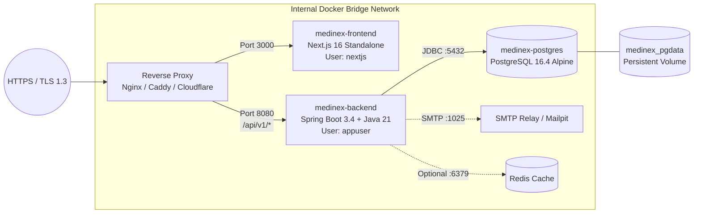

# MEDINEX — PRODUCTION & STAGING DEPLOYMENT GUIDE

**Platform:** MediNex — *"Healthcare Innovation. Connected Communities."*  
**Target Environments:** Staging Server / Production VPS / Cloud Container Platforms  
**Document Version:** 1.0 (Release Candidate Audit)  
**Date:** November 11, 2026  

---

## 1. INFRASTRUCTURE TOPOLOGY

MediNex runs as a decoupled multi-container application managed via Docker Compose on an isolated internal bridge network (`medinex-network`).



### Container Specifications
- **Frontend (`medinex-frontend`):** `node:22-alpine` minimal runner executing as non-root `nextjs` (UID 10001). Exposes port `3000`.
- **Backend (`medinex-backend`):** `eclipse-temurin:21-jre-alpine` layered JAR runner executing as non-root `appuser` (UID 10001). Exposes port `8080` (API) and `8081` (Management/Actuator).
- **Database (`medinex-postgres`):** `postgres:16.4-alpine` storing relational community data on persistent named volume `medinex_pgdata`. Never expose port `5432` to the public internet in production.

---

## 2. PRE-DEPLOYMENT VERIFIED BASELINE

Commit `142aa7b` resolved the audit release blockers and verified full containerized startup against PostgreSQL 16.4:

1. **Schema & Role Authority Migrations Applied (`V1`–`V4`):** Forward-only migrations `V3__align_collection_tables.sql` and `V4__align_role_names.sql` align `@ElementCollection` tables and `roles.name` authorities with `hibernate.ddl-auto: validate`.
2. **Controller RBAC & Route Path Aligned:** `ProjectController.updateProject` and `TeamController.updateMember` enforce `ROLE_SUPER_ADMIN`/`ROLE_ADMIN`, and `SERVER_SERVLET_CONTEXT_PATH=/` prevents double `/api/v1` prefixing.
3. **Host Software Requirements:**
   - Docker Engine 24+ and Docker Compose v2.20+
   - Minimum 2 vCPU, 4 GB RAM, 20 GB SSD
   - TLS termination reverse proxy (Nginx, Caddy, or Traefik)

---

## 3. ENVIRONMENT VARIABLES & SECRET GENERATION

Never deploy using `.env.example` default keys. Generate cryptographically secure random secrets on the host machine:

```bash
# Generate 512-bit JWT Secret Key (hex)
openssl rand -hex 64

# Generate Strong PostgreSQL Database Password
openssl rand -base64 32

# Generate Secure Seed Admin Password
openssl rand -base64 24
```

Create a production `.env` file (`chmod 600 .env`) at the repository root:

```ini
# Environment Mode
NODE_ENV=production
SPRING_PROFILES_ACTIVE=prod
SERVER_SERVLET_CONTEXT_PATH=/

# Public Domain & Endpoints
NEXT_PUBLIC_APP_NAME="MediNex"
NEXT_PUBLIC_APP_TAGLINE="Healthcare Innovation. Connected Communities."
NEXT_PUBLIC_APP_URL="https://medinex.health"
NEXT_PUBLIC_API_BASE_URL="https://api.medinex.health/api/v1"

# Strict CORS Origins (Must match public frontend domain)
CORS_ALLOWED_ORIGINS="https://medinex.health,https://www.medinex.health"

# Database Credentials
POSTGRES_DB=medinex_prod_db
POSTGRES_USER=medinex_prod_user
POSTGRES_PASSWORD=<GENERATED_DB_PASSWORD>

# Cryptographic JWT Secrets
JWT_SECRET_KEY=<GENERATED_512_BIT_HEX_SECRET>
JWT_ACCESS_TOKEN_EXPIRATION_MS=900000
JWT_REFRESH_TOKEN_EXPIRATION_MS=604800000

# Email SMTP Configuration (Production Relay)
MAIL_HOST=smtp.resend.com
MAIL_PORT=587
MAIL_USERNAME=resend
MAIL_PASSWORD=<SMTP_API_KEY>
MAIL_FROM_ADDRESS=noreply@medinex.health

# Initial Super Admin Credentials (Override defaults!)
SEED_ADMIN_EMAIL=lead-admin@medinex.health
SEED_ADMIN_PASSWORD=<GENERATED_ADMIN_PASSWORD>
```

---

## 4. REVERSE PROXY, HTTPS & CORS CONFIGURATION

In production, all public traffic must traverse TLS 1.3 via a reverse proxy. Next.js security headers enforce HSTS (`max-age=63072000; includeSubDomains; preload`) and `X-Frame-Options: DENY`.

### Example Nginx Site Configuration (`/etc/nginx/sites-available/medinex`)

```nginx
# Frontend Server Block
server {
    listen 443 ssl http2;
    server_name medinex.health www.medinex.health;

    ssl_certificate /etc/letsencrypt/live/medinex.health/fullchain.pem;
    ssl_certificate_key /etc/letsencrypt/live/medinex.health/privkey.pem;
    ssl_protocols TLSv1.2 TLSv1.3;

    location / {
        proxy_pass http://127.0.0.1:3002;
        proxy_http_version 1.1;
        proxy_set_header Upgrade $http_upgrade;
        proxy_set_header Connection 'upgrade';
        proxy_set_header Host $host;
        proxy_set_header X-Real-IP $remote_addr;
        proxy_set_header X-Forwarded-For $proxy_add_x_forwarded_for;
        proxy_set_header X-Forwarded-Proto $scheme;
    }
}

# Backend API Server Block
server {
    listen 443 ssl http2;
    server_name api.medinex.health;

    ssl_certificate /etc/letsencrypt/live/api.medinex.health/fullchain.pem;
    ssl_certificate_key /etc/letsencrypt/live/api.medinex.health/privkey.pem;
    ssl_protocols TLSv1.2 TLSv1.3;

    # Block external access to Actuator Management Endpoints
    location /actuator {
        deny all;
        return 403;
    }

    location / {
        proxy_pass http://127.0.0.1:8082;
        proxy_http_version 1.1;
        proxy_set_header Host $host;
        proxy_set_header X-Real-IP $remote_addr;
        proxy_set_header X-Forwarded-For $proxy_add_x_forwarded_for;
        proxy_set_header X-Forwarded-Proto $scheme;
        client_max_body_size 10M;
    }
}
```

---

## 5. CONTAINER BUILD & DEPLOYMENT WORKFLOW

### Step 1: Validate Environment & Build Images
```bash
# Pull latest tagged release
git checkout main
git pull origin main

# Build clean multi-stage production images
docker compose build --no-cache
```

### Step 2: Launch Services with Health Verification
```bash
# Start Postgres first and wait for health check
docker compose up -d postgres
docker compose ps postgres

# Launch backend and frontend services
docker compose up -d
```

### Step 3: Monitor Migrations & Service Readiness
Watch backend logs to confirm Flyway applies `V1` through `V6__restrict_contributor_roles.sql` cleanly (`V6` restricts seeded contributor accounts to `ROLE_USER` while preserving admin accounts and all existing user rows):
```bash
docker compose logs -f backend
```
Verify Actuator health endpoint locally on the server:
```bash
curl -f http://127.0.0.1:8083/actuator/health
# Expected: {"status":"UP"}
```
Verify Frontend response:
```bash
curl -sI http://127.0.0.1:3002 | grep "HTTP/1.1 200"
```

---

## 6. DATABASE & MEDIA VOLUME BACKUP & DISASTER RECOVERY RUNBOOKS

Automated database backup scripts with SHA-256 verification and 7-day retention are stored in `infrastructure/scripts/`. Never run `docker compose down -v`, as doing so destroys both `medinex_pgdata` and `medinex_uploads` (`/app/uploads`).

### Uploaded Media Volume (`medinex_uploads`) Backup & Restore
`medinex-backend` mounts `medinex_uploads` at `/app/uploads` (owned by `appuser:10001`). Pure-Java WebP/JPEG/PNG decoding (`imageio-webp:3.13.1`) avoids native `musl` JNI dependencies on Alpine.

```bash
# Archive medinex_uploads cleanly without stopping PostgreSQL
docker run --rm -v medinex_uploads:/source:ro -v "$(pwd)/infrastructure/backups:/backup" alpine \
  tar czf /backup/medinex_uploads_$(date +%Y%m%d).tar.gz -C /source .

# Restore medinex_uploads into persistent volume
docker run --rm -v medinex_uploads:/restore -v "$(pwd)/infrastructure/backups:/backup:ro" alpine \
  tar xzf /backup/medinex_uploads_<DATE>.tar.gz -C /restore
```

### Automated Daily Backup (Linux Cron Example)
Add to root crontab (`crontab -e`) to execute daily at 02:00 UTC:
```bash
0 2 * * * /opt/medinex/infrastructure/scripts/backup.sh >> /var/log/medinex-backup.log 2>&1
```

Manual execution:
```bash
# Linux / macOS
./infrastructure/scripts/backup.sh

# Windows PowerShell
.\infrastructure\scripts\backup.ps1
```
Output generates compressed `.dump` archives and `.sha256` checksum files in `infrastructure/backups/`.

---

## 7. ROLLBACK STRATEGY

If a post-deployment issue occurs (e.g., failed Flyway migration, regression, or container crash), execute the following rollback workflow immediately:

### Phase A: Database Rollback
1. Stop application containers to terminate active connections:
   ```bash
   docker compose stop backend frontend
   ```
2. Restore the last known good database dump:
   ```bash
   ./infrastructure/scripts/restore.sh ./infrastructure/backups/medinex_backup_<TIMESTAMP>.dump
   ```

### Phase B: Code & Container Image Rollback
1. Check out the previously stable release commit tag:
   ```bash
   git checkout <PREVIOUS_TAG_OR_COMMIT>
   ```
2. Rebuild and restart services:
   ```bash
   docker compose up -d --build
   ```
3. Verify health probes:
   ```bash
   docker compose ps
   curl -f http://127.0.0.1:8083/actuator/health
   ```
