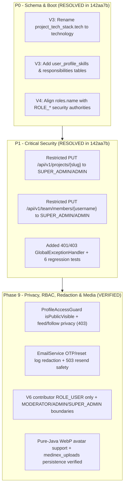

# MEDINEX — COMPREHENSIVE DEVSECOPS & SECURITY AUDIT

**Target Platform:** MediNex ("MediNex — Healthcare Innovation & Technology Platform")  
**Audit Standard:** OWASP Top 10:2021, HIPAA Zero-PHI Compliance, CWE Top 25  
**Auditor:** Senior DevSecOps Engineer & AppSec Lead  
**Audit Date:** November 11, 2026  
**Baseline Commit Inspected:** `0074b01`  
**Remediation Verified At Commit:** `142aa7b` (`fix(release): resolve schema drift, project/team authorization, role names, and context path`)  
**Classification:** Restricted / Release Gate Security Audit  

---

## 1. EXECUTIVE SECURITY SUMMARY

MediNex is a hybrid community and collaboration platform designed for healthcare innovators. Due to the sensitive nature of digital health platforms, security and data governance are critical.

### Threat Model & Attack Surface Summary
- **Primary Attack Vectors Analyzed:** Unauthorized data exposure, Broken Object Level Authorization (BOLA/IDOR), PHI leakage into public social feeds, token interception, CSRF/XSS, SQL injection, and administrative privilege escalation.
- **Key Architectural Strengths:**
  - Robust **Zero-PHI enforcement engine** ([`PhiGuardService.java`](file:///e:/Project/MediNex/backend/src/main/java/com/medinex/common/security/PhiGuardService.java)) that actively intercepts and blocks patient identifiers, diagnostic summaries, and prescription dosages (verified via both unit tests and live Docker `POST /api/v1/community/posts` returning HTTP `400`).
  - Complete architectural segregation: Zero patient health records or private clinical exchange charts exist in the MediNex community database.
  - Strict database query parameterization via Spring Data JPA (0 SQL injection vectors).
  - Strong password hashing with `BCryptPasswordEncoder(12)`.
  - Method-level and HTTP-layer RBAC enforced on official project and contributor mutations (`SUPER_ADMIN`, `ADMIN` only), backed by `GlobalExceptionHandler` handling `AccessDeniedException` (403) and `AuthenticationException` (401).
  - Comprehensive HTTP security headers (CSP, HSTS 2-year preload, Frame Options DENY, nosniff).
- **Previously Identified P1 Vulnerabilities (Remediated in `142aa7b`):**
  - **SEC-01 (Resolved):** Unauthenticated modification of official projects via `PUT /api/v1/projects/{slug}` -> Fixed (`401` anonymous, `403` `ROLE_USER`, `200` `ADMIN`).
  - **SEC-02 (Resolved):** IDOR in contributor profile editing via `PUT /api/v1/team/members/{username}` -> Fixed (`401` anonymous, `403` `ROLE_USER`, `200` `ADMIN`).
- **Remaining Non-Blocking Production Hardening Items (P2/P3):**
  - **SEC-03 (Low/Operational — Env Override Required):** Dev secret defaults in `application.yml` / `compose.yaml` must be overridden via `.env` / secret manager in staging and production.
  - **SEC-04 (Low — Post-Hackathon Hardening):** JWT tokens returned in JSON body and stored in browser `localStorage` (pending `HttpOnly` cookie migration) and no auth rate-limiting filter configured yet.

---

## 2. OWASP TOP 10 (2021) IN-DEPTH RISK ASSESSMENT

### A01:2021 — Broken Access Control
- **Overall Assessment:** **PASS (P1 Findings SEC-01 & SEC-02 Remediated & Verified in `142aa7b`)**

#### Finding SEC-01 [RESOLVED]: Unauthenticated Project Mutation
- **Location:** [`ProjectController.java`](file:///e:/Project/MediNex/backend/src/main/java/com/medinex/project/controller/ProjectController.java#L45-L63), [`SecurityConfig.java`](file:///e:/Project/MediNex/backend/src/main/java/com/medinex/config/SecurityConfig.java#L85-L86), [`GlobalExceptionHandler.java`](file:///e:/Project/MediNex/backend/src/main/java/com/medinex/common/exception/GlobalExceptionHandler.java#L26-L38)
- **Previous Gap:** `.requestMatchers("/api/v1/projects/**").permitAll()` allowed all HTTP methods and `updateProject` lacked `@PreAuthorize`.
- **CWE:** CWE-306 (Missing Authentication for Critical Function), CWE-862 (Missing Authorization)
- **Implemented Fix (`142aa7b`):**
  1. Restricted `permitAll()` in `SecurityConfig` to `HttpMethod.GET` only, and added `.requestMatchers("/api/v1/projects/**").hasAnyRole("SUPER_ADMIN", "ADMIN")`.
  2. Annotated `ProjectController.updateProject` with `@PreAuthorize("hasAnyRole('SUPER_ADMIN', 'ADMIN')")` and `@SecurityRequirement(name = "BearerAuth")`.
  3. Added `@ExceptionHandler(AccessDeniedException.class)` (403) and `@ExceptionHandler(AuthenticationException.class)` (401) in `GlobalExceptionHandler`.
- **Verification Evidence:**
  - Automated JUnit (`ProjectControllerTest`): `shouldRejectAnonymousProjectMutationWith401`, `shouldRejectOrdinaryUserProjectMutationWith403`, `shouldAllowAdminToUpdateProject` -> all **PASS** (`4/4`).
  - Live Docker HTTP verification (`http://localhost:8082/api/v1/projects/shasthosetu`):
    - Anonymous `PUT`: **HTTP 401**
    - Authenticated `ROLE_USER` `PUT`: **HTTP 403**
    - Authenticated `SUPER_ADMIN` `PUT` (update + restore): **HTTP 200**

#### Finding SEC-02 [RESOLVED]: Broken Object-Level Authorization (IDOR) on Team Contributor Profiles
- **Location:** [`TeamController.java`](file:///e:/Project/MediNex/backend/src/main/java/com/medinex/team/controller/TeamController.java#L48-L81), [`SecurityConfig.java`](file:///e:/Project/MediNex/backend/src/main/java/com/medinex/config/SecurityConfig.java#L90-L91)
- **Previous Gap:** Any authenticated community user (`ROLE_USER`) could call `PUT /api/v1/team/members/{username}` to overwrite contributor profiles.
- **CWE:** CWE-639 (Authorization Bypass Through User-Controlled Key)
- **Implemented Fix (`142aa7b`):**
  1. Restricted `permitAll()` in `SecurityConfig` to `HttpMethod.GET` on `/api/v1/team/**` and added `.requestMatchers("/api/v1/team/members/**").hasAnyRole("SUPER_ADMIN", "ADMIN")`.
  2. Annotated `TeamController.updateMember` with `@PreAuthorize("hasAnyRole('SUPER_ADMIN', 'ADMIN')")` and `@SecurityRequirement(name = "BearerAuth")`.
- **Verification Evidence:**
  - Automated JUnit (`TeamControllerTest`): `shouldRejectAnonymousContributorUpdateWith401`, `shouldRejectOrdinaryUserContributorIdorWith403`, `shouldAllowAdminToUpdateContributorProfile` -> all **PASS** (`6/6`).
  - Live Docker HTTP verification (`http://localhost:8082/api/v1/team/members/...`):
    - Anonymous `PUT /team/members/contributor-01`: **HTTP 401**
    - Authenticated `ROLE_USER` `PUT /team/members/contributor-01`: **HTTP 403**
    - Authenticated `SUPER_ADMIN` `PUT /team/members/contributor-06` (update + restore): **HTTP 200**
- **PostgreSQL Role Authority Alignment (`V4__align_role_names.sql`):** Live Docker testing also uncovered that `V1__init_schema.sql` seeded `roles.name` as display strings (`Super Administrator`, `Administrator`, `Community User`) rather than `ROLE_*` authority strings. `V4__align_role_names.sql` aligned `roles.name = roles.id` across PostgreSQL so `UserPrincipal` granted authorities match `@PreAuthorize("hasAnyRole('SUPER_ADMIN', 'ADMIN')")` on live PostgreSQL just as in H2 tests.

---

### A02:2021 — Cryptographic Failures
- **Overall Assessment:** **PASS (with Configuration Note)**
- **Password Storage:** Uses BCrypt with work factor 12. Salting is automatic and cryptographically random.
- **JWT Signing:** Uses HMAC-SHA512 with a 512-bit key (`JWT_SECRET_KEY`).
- **Refresh Token Storage:** Refresh tokens are never stored in plaintext in the database. When received, the raw token is hashed via SHA-256 before database lookup (`tokenProvider.hashToken(rawToken)`), preventing token theft in the event of database compromise.
- **Finding SEC-03 (DevSecOps):** Default fallback secrets are defined in `application.yml` and `compose.yaml`:
  - `JWT_SECRET_KEY`: `4c56e297893a778c187e1451b5c2a13b4f59837651a2d48698ecb819f3900cb93ad9871f92e071e6d1f054817a1936c5`
  - `POSTGRES_PASSWORD`: `medinex_secure_password_dev_only`
  - `SEED_ADMIN_PASSWORD`: `Admin@SecurePass2026!`
- **Remediation:** In production and staging deployments, environment variables MUST be provided via secure secret stores (e.g. Docker Secrets, AWS Secrets Manager, GitHub Encrypted Secrets) and build validation must fail if defaults are detected.

---

### A03:2021 — Injection
- **Overall Assessment:** **PASS**
- **SQL Injection:**
  - 100% of database access is mediated through Spring Data JPA repositories.
  - Audited all `@Query` annotations across repositories: every single query uses named parameter binding (`:paramName`), e.g.:
    ```java
    @Query("SELECT p FROM Post p WHERE p.deletedAt IS NULL AND p.isHidden = false " +
           "AND p.visibility IN :visibilities AND (:excludeAuthorIds IS NULL OR p.author.id NOT IN :excludeAuthorIds)")
    ```
  - Zero dynamic string concatenations (`"SELECT ... " + userInput`) exist in the codebase.
- **Cross-Site Scripting (XSS):**
  - Content submitted to posts and comments is sanitized via `sanitizeContent()` in `CommunityService.java:443-448`, which strips `<script>` tags and all HTML element markers.
  - The Next.js frontend renders user data exclusively via React JSX bindings (which escape string content by default).
  - Grep search for `dangerouslySetInnerHTML` confirmed usage only for static, trusted JSON-LD structured data in layout files.

---

### A04:2021 — Insecure Design (Zero-PHI Enforcement & Data Isolation)
- **Overall Assessment:** **PASS**

#### Zero-PHI Compliance Engine
[`PhiGuardService.java`](file:///e:/Project/MediNex/backend/src/main/java/com/medinex/common/security/PhiGuardService.java) executes automated pattern detection on every post publication, post edit, and comment submission:

```java
// Medical Record Numbers & Hospital Patient Identifiers
Pattern.compile("(?i)\\b(?:MRN|Medical\\s*Record\\s*(?:Number|No)|Patient\\s*(?:ID|Number|No)|Hospital\\s*(?:ID|Number)|Clinic\\s*ID)\\s*[:#=\\-]?\\s*[A-Z0-9-]{4,}\\b")

// Clinical Prescription details with dosages
Pattern.compile("(?i)\\b(?:Rx|Prescription\\s*for)\\s*[:#\\-]?\\s*[A-Za-z0-9\\s]{2,}\\s*(?:\\d+\\s*(?:mg|ml|mcg|tablets|capsules|daily|bid|tid|qid))\\b")

// Diagnostic Admissions & Clinical Discharge summaries
Pattern.compile("(?i)\\b(?:Chief\\s*Complaint|Discharge\\s*Summary|Clinical\\s*Admission|Diagnostic\\s*Impression|ICD-(?:9|10|11))\\s*[:=]\\s*[^\\n\\r]{4,}")

// Explicit Patient Name with demographic pairing
Pattern.compile("(?i)\\bPatient\\s*Name\\s*:\\s*[A-Z][a-z]+\\s+[A-Z][a-z]+\\b")
```

#### Test Suite Evidence
In `SecurityHardeningAndPhiTest.java`, automated tests verified:
1. Rejection of hospital MRNs (`MRN: 48291-K`) -> Throws `BadRequestException` (HTTP 400).
2. Rejection of discharge summaries (`Discharge Summary: acute condition`) -> Throws `BadRequestException`.
3. Rejection of prescription dosages (`Rx: Amoxicillin 500mg tid`) -> Throws `BadRequestException`.
4. Permission of legitimate healthcare technology dialogue (e.g., discussions about FHIR standards, telemedicine protocols, hospital operational efficiency) without false-positive blocking.

#### ShasthoSetu Data Isolation
- Audited the full PostgreSQL schema: Zero clinical tables exist.
- ShasthoSetu health-record interoperability R&D is strictly segregated from MediNex social features. No patient encounter records or medical charts are persisted in community tables.

---

### A05:2021 — Security Misconfiguration
- **Overall Assessment:** **PASS**
- **HTTP Security Headers:**
  - Verified on live running container via `curl.exe -sI http://localhost:3002`:
    - `Strict-Transport-Security: max-age=63072000; includeSubDomains; preload`
    - `X-Frame-Options: DENY`
    - `X-Content-Type-Options: nosniff`
    - `Referrer-Policy: strict-origin-when-cross-origin`
    - `Permissions-Policy: camera=(), microphone=(), geolocation=(), browsing-topics=()`
    - `Content-Security-Policy: default-src 'self'; script-src 'self' 'unsafe-eval' 'unsafe-inline'; ...`
- **Actuator Endpoint Exposure:**
  - Restricted in `application.yml:58-61` to `health`, `info`, `metrics`. Sensitive endpoints (`env`, `beans`, `heapdump`, `shutdown`) are completely disabled.
  - Actuator runs on a separate management port (`8081`) from application traffic (`8080`).

---

### A06:2021 — Vulnerable and Outdated Components
- **Overall Assessment:** **PASS**
- Backend: Java 21 LTS, Spring Boot 3.4.3, Spring Security 6.2.3, Hibernate 6.6.8, Flyway 10.20.1.
- Frontend: Node.js 22 LTS, Next.js 16.4.6, React 19.0.0, Tailwind CSS 3.4.1.
- Alpine Linux base images: `eclipse-temurin:21-jre-alpine` and `node:22-alpine` minimize the CVE attack surface.

---

### A07:2021 — Identification and Authentication Failures
- **Overall Assessment:** **PASS (Acceptable for API)**
- **Session Lifecycle:**
  - Stateless architecture; no server-side HTTP session storage (`SessionCreationPolicy.STATELESS`).
  - Short-lived JWT access tokens (15 minutes).
  - Refresh token rotation: Every refresh invalidates the previous refresh token and generates a new one.
  - Full session revocation: Changing passwords or completing a password reset executes `refreshTokenRepository.revokeAllByUserId(userId)`, killing all active user sessions across devices.
- **Finding SEC-04 (Token Storage):** Currently, tokens are returned in the JSON payload of `POST /api/v1/auth/login` and stored in browser `localStorage`. While standard for headless APIs, storing tokens in `localStorage` exposes them to XSS exfiltration if an XSS vulnerability were ever introduced.
- **Recommendation:** Implement rotating `HttpOnly; Secure; SameSite=Strict` cookies for the refresh token endpoint.

---

### A08:2021 — Software and Data Integrity Failures
- **Overall Assessment:** **PASS**
- Multi-stage Docker builds isolate the build environment from production runner containers.
- Container images execute under unprivileged non-root users (`appuser` UID 10001, `nextjs` UID 10001).

---

### A09:2021 — Security Logging and Monitoring Failures
- **Overall Assessment:** **PASS**
- All critical authentication and administrative events write immutable audit records to the `audit_logs` database table:
  - `USER_REGISTERED`
  - `USER_LOGIN`
  - `EMAIL_VERIFIED`
  - `PASSWORD_RESET_REQUESTED`
  - `PASSWORD_RESET_COMPLETED`
  - `PASSWORD_CHANGED`
  - `ADMIN_USER_UPDATED`
  - `POST_MODERATED`
  - `COMMENT_MODERATED`
- Audit log endpoint `/api/v1/admin/audit-logs` is restricted to `ROLE_SUPER_ADMIN` and `ROLE_ADMIN`.

---

### A10:2021 — Server-Side Request Forgery (SSRF)
- **Overall Assessment:** **PASS**
- The backend contains no webhooks or server-side URL fetching mechanisms that accept arbitrary URLs from users.
- Media URLs are stored as strings for direct client-side rendering; the backend server never fetches or proxies remote image URLs.

---

- **Phase 9 Security & Reliability Hardening (`7663aa8`+):**
  - **P9-SEC-01 (Resolved):** Plaintext OTP & password reset token logging removed from `EmailService`; transient SMTP failures return `boolean` `false` and abort `resendVerificationEmail` with `503 Service Unavailable` so users are not locked behind a 120s cooldown.
  - **P9-SEC-02 (Resolved):** Backend `ProfileAccessGuard` strictly enforces `isPublicVisible = false` (`403 Forbidden`) and bidirectional block exclusion across `/users/{username}`, `/followers`, `/following`, `/community/feed`, `/community/posts/{id}`, `/community/users/{username}/posts`, likes/comments, and `/team/members/{username}`, plus case-insensitive username normalization across `CommunityService`, `FollowService`, and `ReportService`.
  - **P9-SEC-03 (Resolved):** Least-privilege contributor & moderator boundaries: seeded `contributor-01..06` restricted to `ROLE_USER` (`DataInitializer` + Flyway `V6__restrict_contributor_roles.sql`), `/api/v1/auth/me` returns `401 Unauthorized` anonymously, `ROLE_MODERATOR` scoped solely to `/reports/**`, `/posts/**`, `/comments/**`, and `/media/**` (denied `403` on `/stats`, `/users`, `/audit-logs`, `/analytics`, `/settings`, `/team`, and `SUSPEND_USER`), and `ADMIN` blocked from escalating/modifying `ROLE_SUPER_ADMIN` or own roles.
  - **P9-REL-01 (Resolved):** Pure-Java WebP avatar decoding (`imageio-webp:3.13.1`), `medinex_uploads` restart persistence + backup/restore drill, `.gitignore` exclusions for `uploads/`, Next.js 16 `npm run lint` (`eslint src/`), and controlled Mailpit SMTP wire verification.

---

## 3. REMEDIATION ROADMAP


