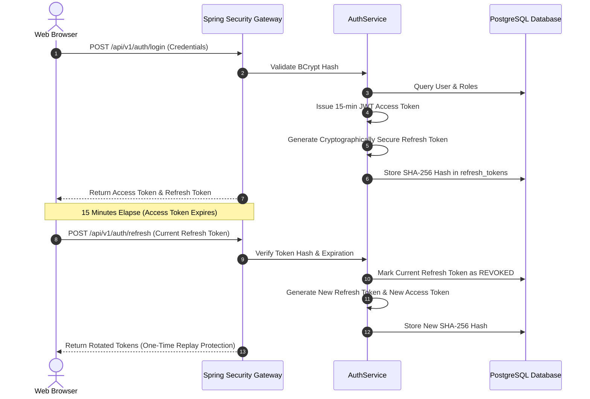

# MediNex DevSecOps, Security Architecture & Hardening Guide

## 1. Cardinal Healthcare Data Isolation Policy (Zero-PHI)

MediNex enforces strict healthcare data governance and separation boundaries across its collaborative technology platform:

- **No Protected Health Information (PHI):** The public community platform database does **NOT** collect, index, or store patient medical records, hospital admission records, physician diagnostic prescriptions, national IDs, or clinical imaging scans.
- **Automated Interception Engine ([`PhiGuardService.java`](backend/src/main/java/com/medinex/common/security/PhiGuardService.java)):** Every community post, comment, and message submission is scanned for clinical indicators before reaching persistence:
  - Medical Record Numbers (`MRN`, `Hospital ID`, `Clinic ID`).
  - Prescription dosages with unit metrics (`Rx: [Medication] [Dosage] mg/ml bid/tid`).
  - Clinical diagnostic admissions (`Chief Complaint:`, `Discharge Summary:`, `ICD-10:`).
  - Explicit patient demographic pairings (`Patient Name:`, `Patient DOB:`).
- **Enforcement Action:** Detected violations are halted immediately and rejected with `400 Bad Request` and an explicit security warning explaining the Zero-PHI policy.
- **Architectural Segregation:** ShasthoSetu is an isolated interoperable health-record research initiative. Social community JWT access tokens possess zero access authority over clinical or patient-record exchange pipelines.

---

## 2. Authentication, Token Rotation & Session Security

- **Password Hashing:** Passwords are never stored in plaintext. They are hashed using **BCrypt** with an adaptive work factor of 12.
- **Short-Lived Access Tokens:** Signed using HMAC-SHA256 with a 15-minute validity window.
- **Rotating Refresh Tokens:** 7-day duration, stored as SHA-256 hashes in the `refresh_tokens` table. Used refresh tokens are immediately marked `revoked = true` to detect replay attempts.
- **Token Revocation & Logout:** Logging out immediately invalidates the active refresh token hash in the database.

---

## 3. Role-Based Access Control (RBAC) Matrix

Least-privilege access is enforced across both backend controllers (`@PreAuthorize`) and frontend routing:

| Capability / Route | `ROLE_SUPER_ADMIN` | `ROLE_ADMIN` | `ROLE_MODERATOR` | `ROLE_USER` | `PUBLIC` (Unauthenticated) |
| :--- | :---: | :---: | :---: | :---: | :---: |
| **Browse Landing, Team, Projects, Feed** | Allowed | Allowed | Allowed | Allowed | Allowed |
| **Get Current Authenticated User (`/auth/me`)** | Allowed | Allowed | Allowed | Allowed | Denied (401) |
| **Publish Posts, Comments, Like** | Allowed | Allowed | Allowed | Allowed | Denied (401) |
| **Follow Team & Community Users** | Allowed | Allowed | Allowed | Allowed | Denied (401) |
| **Official Team Announcements** | Allowed | Allowed | Denied | Denied | Denied (403) |
| **Admin Stats, Users & Analytics** | Allowed | Allowed | Denied (403) | Denied (403) | Denied (401) |
| **User Status Switch (Suspend/Activate)** | Allowed | Allowed* | Denied (403) | Denied (403) | Denied (401) |
| **Role Modification** | Allowed | Allowed* | Denied (403) | Denied (403) | Denied (401) |
| **Team Contributor Governance** | Allowed | Allowed | Denied (403) | Denied (403) | Denied (401) |
| **Project Stage & Specs Editing** | Allowed | Allowed | Denied (403) | Denied (403) | Denied (401) |
| **Content Moderation (Posts/Comments/Media)** | Allowed | Allowed | Allowed | Denied (403) | Denied (401) |
| **Resolve Reports (`HIDE_POST`, `HIDE_COMMENT`, `NONE`)** | Allowed | Allowed | Allowed | Denied (403) | Denied (401) |
| **Resolve Reports with `SUSPEND_USER`** | Allowed | Allowed* | Denied (403) | Denied (403) | Denied (401) |
| **Audit Logs Inspection** | Allowed | Allowed | Denied (403) | Denied (403) | Denied (401) |
| **Platform Runtime Settings** | Allowed | Allowed | Denied (403) | Denied (403) | Denied (401) |

> [!NOTE]
> Public registration defaults exclusively to `ROLE_USER`. Privileged roles cannot be self-assigned during registration. Seeded contributors (`contributor-01`..`contributor-06`) also carry `ROLE_USER` only (`DataInitializer` + Flyway `V6__restrict_contributor_roles.sql`), and `*` non-`SUPER_ADMIN` admins cannot assign/modify `ROLE_SUPER_ADMIN`, suspend `SUPER_ADMIN`, or alter their own roles/status (`403 Forbidden`).

---

## 4. HTTP Security Headers Hardening

### Frontend Next.js Configuration ([`next.config.ts`](frontend/next.config.ts))
- **`Content-Security-Policy`:**
  - `default-src 'self'`
  - `script-src 'self' 'unsafe-eval' 'unsafe-inline'`
  - `style-src 'self' 'unsafe-inline'`
  - `img-src 'self' blob: data: https://images.unsplash.com https://avatars.githubusercontent.com`
  - `font-src 'self' data: https://fonts.gstatic.com`
  - `connect-src 'self' http://localhost:8080 http://localhost:8082 http://127.0.0.1:8082 https:`
  - `frame-ancestors 'none'`
  - `base-uri 'self'`
  - `form-action 'self'`
- **`Strict-Transport-Security`:** `max-age=63072000; includeSubDomains; preload`.
- **`X-Frame-Options`:** `DENY`.
- **`X-Content-Type-Options`:** `nosniff`.
- **`Referrer-Policy`:** `strict-origin-when-cross-origin`.
- **`Permissions-Policy`:** `camera=(), microphone=(), geolocation=(), browsing-topics=()`.

### Backend Spring Security Configuration ([`SecurityConfig.java`](backend/src/main/java/com/medinex/config/SecurityConfig.java))
- `X-Content-Type-Options: nosniff`
- `X-Frame-Options: DENY`
- `X-XSS-Protection: 0`
- `Cache-Control: no-cache, no-store, max-age=0, must-revalidate`
- `Strict-Transport-Security: max-age=31536000; includeSubDomains`

---

## 5. Input Validation, Privacy Controls, XSS & Media Hardening

- **Private Profile & Block Isolation ([`ProfileAccessGuard.java`](backend/src/main/java/com/medinex/user/service/ProfileAccessGuard.java)):** Enforces `isPublicVisible` and bidirectional block isolation uniformly across profile lookups, follower/following lists, team contributor profiles, community feeds (`PostRepository.findFeedPosts`), post threads, comments, likes, and user post lists. Private profiles return `403 Forbidden` to anonymous callers and non-followers, admitting only the profile owner and accepted followers (`user_follows`). Anonymous access to `MEMBERS_ONLY` posts or `/api/v1/auth/me` returns `401 Unauthorized`.
- **Credential Log Redaction ([`EmailService.java`](backend/src/main/java/com/medinex/common/email/EmailService.java)):** Verification OTPs and password reset tokens are strictly omitted from application logs (`(OTP redacted)` / `(token redacted)`). Transient SMTP failures return `false` to `AuthService`, which aborts resend cooldown registration with `503 Service Unavailable`.
- **SQL Injection:** 100% Parameterized queries via Hibernate and Spring Data JPA. Zero raw SQL string concatenation. Usernames resolve case-insensitively (`findByUsernameIgnoreCase`).
- **Cross-Site Scripting (XSS):**
  - Content sanitization strips `<script>` blocks and dangerous HTML elements prior to database persistence.
  - React/Next.js default JSX string escaping protects against DOM-based XSS.
- **Attachment & Avatar Media Security ([`AvatarImageService.java`](backend/src/main/java/com/medinex/user/service/AvatarImageService.java)):**
  - Avatar uploads accept validated JPEG, PNG, and WebP streams (decoded in pure Java via TwelveMonkeys `imageio-webp`), enforce a 5 MB ceiling, strip metadata/EXIF by re-encoding normalized 64px/256px/512px JPEGs, and use normalized UUID filenames to prevent directory traversal.
  - Community post attachments support up to 4 validated images per post (`image/jpeg`, `image/png`, `image/webp`).

---

## 6. Immutable Security Audit Trail ([`audit_logs`](backend/src/main/java/com/medinex/audit/entity/AuditLog.java))

All critical security and administrative actions are logged synchronously to the `audit_logs` table:
- **Captured Attributes:** UTC timestamp, actor user UUID, actor email, action string (`USER_LOGIN`, `USER_REGISTERED`, `USER_STATUS_UPDATED`, `ROLE_MODIFIED`, `POST_MODERATED`, `REPORT_RESOLVED`, `SITE_SETTINGS_UPDATED`, `TEAM_MEMBER_UPDATED`), client IP address, user agent, target entity type, target UUID, and JSONB change metadata.
- **Immutability:** Audit records have no update or delete API endpoints. They remain an indelible record for compliance reviews.

---

## 7. Container & Runtime DevSecOps Hardening

- **Non-Root Execution:**
  - Frontend runs under system user `nextjs:10001`.
  - Backend runs under system user `appuser:10001`.
- **Database Boundary:**
  - PostgreSQL container is wired exclusively to the internal bridge network (`medinex-network`).
  - Production environments omit public port binding (`5432` is not exposed externally).
- **Secret Isolation:**
  - Zero secrets or API keys are baked into Docker container images.
  - All credentials injected at container runtime via environment variables.
  - `.env` files are strictly excluded from source control (`.gitignore`).
