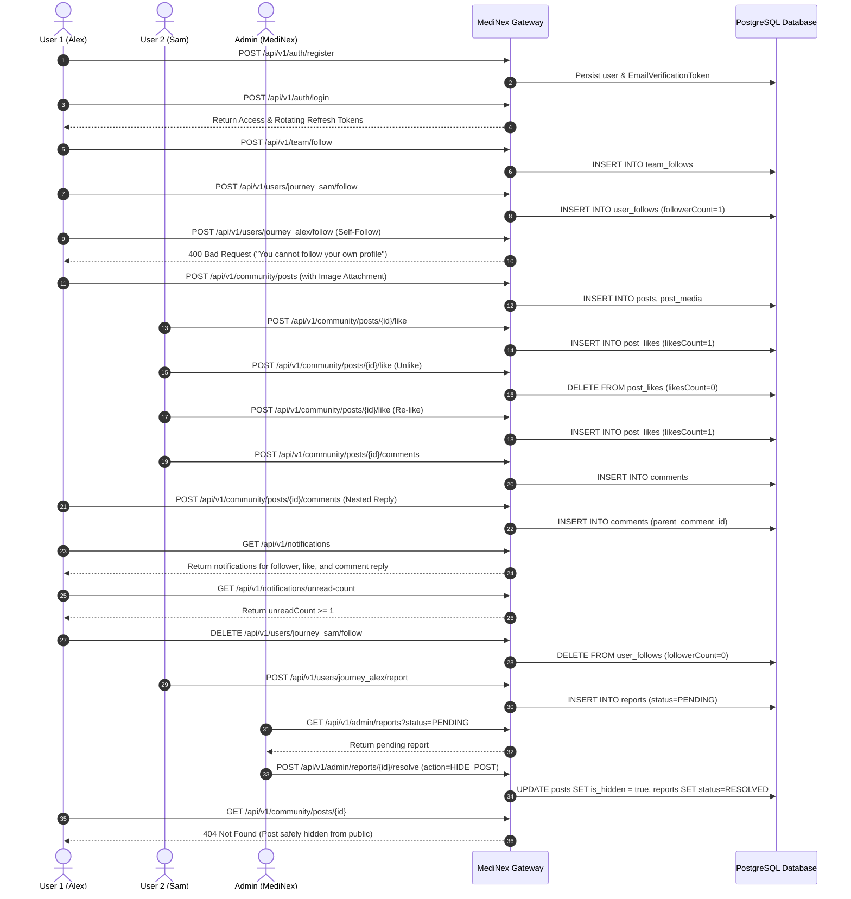

# MediNex Quality Assurance & Testing Suite

## Testing Philosophy

MediNex adheres strictly to the non-negotiable rule:
> **Never claim tests passed unless they were actually executed.**
> No mock passes, no fabricated green status, and no skipping security assertions.

---

## 1. Backend Testing Suite (JUnit 5, MockMvc, Spring Boot Test)

Located in `backend/src/test/java/com/medinex/`:

| Test Suite / Class | Scope | Executed Tests | Key Assertions & Scenarios | Status |
| :--- | :--- | :---: | :--- | :---: |
| [`MediNexApplicationTests.java`](backend/src/test/java/com/medinex/MediNexApplicationTests.java) | Context | 1 | Spring Boot 3.4 context bootstrap and bean wiring verification. | **PASS** |
| [`TeamControllerTest.java`](backend/src/test/java/com/medinex/team/TeamControllerTest.java) | Team API | 6 | Asserts 6 contributor profiles, case/lookup behavior, and `401`/`403` update protections. | **PASS** |
| [`ProjectControllerTest.java`](backend/src/test/java/com/medinex/project/ProjectControllerTest.java) | Projects API | 4 | Asserts ShasthoSetu specifications, `DEVELOPMENT` stage, and `401`/`403` update protections. | **PASS** |
| [`AuthIntegrationTest.java`](backend/src/test/java/com/medinex/auth/AuthIntegrationTest.java) | Identity & Auth | 13 | OTP verification, resend cooldown, `503` transient SMTP retry preservation, log redaction via `@MockitoSpyBean`, `ROLE_USER`-only registration, refresh token rotation/revocation. | **PASS** |
| [`EmailServiceTest.java`](backend/src/test/java/com/medinex/common/email/EmailServiceTest.java) | Email Redaction | 2 | Verifies OTP & password-reset token redaction from logs and `false` return on `MailSendException`. | **PASS** |
| [`FollowIntegrationTest.java`](backend/src/test/java/com/medinex/follow/FollowIntegrationTest.java) | Follower Graph | 6 | Team follow/unfollow, member follow/unfollow, mutual block enforcement, follow requests (pending/accept/reject), self-follow prevention. | **PASS** |
| [`CommunityIntegrationTest.java`](backend/src/test/java/com/medinex/community/CommunityIntegrationTest.java) | Community Feed | 7 | Post creation, public feed retrieval, like toggling, hierarchical comments/replies, soft deletion, unauthorized update rejection. | **PASS** |
| [`AdminIntegrationTest.java`](backend/src/test/java/com/medinex/admin/AdminIntegrationTest.java) | Admin Console | 6 | RBAC `403` enforcement, real DB stats, role/status switches with audit logs, moderation queue resolution, settings & analytics. | **PASS** |
| [`PrivacyAndRbacIntegrationTest.java`](backend/src/test/java/com/medinex/security/PrivacyAndRbacIntegrationTest.java) | Phase 9 Privacy & RBAC | 4 | Private profile `403` (anon/non-follower/pending vs owner/accepted follower), `PRIVATE` post visibility, mixed-case usernames, contributor `ROLE_USER` limit, `ADMIN` vs `SUPER_ADMIN` escalation guard, `ROLE_MODERATOR` boundaries, `/auth/me` `401`. | **PASS** |
| [`SecurityHardeningAndPhiTest.java`](backend/src/test/java/com/medinex/security/SecurityHardeningAndPhiTest.java) | DevSecOps & PHI | 5 | Clinical MRN/diagnostic detection, health tech dialogue allowed, post & comment `400` rejection, security headers. | **PASS** |
| [`AvatarUploadIntegrationTest.java`](backend/src/test/java/com/medinex/user/AvatarUploadIntegrationTest.java) | Avatar Media | 5 | Multi-resolution JPEG/PNG resize (`64/256/512px`), lossy VP8 & lossless VP8L WebP uploads, storage reload persistence, invalid upload validation. | **PASS** |
| [`FullUserJourneyE2EIntegrationTest.java`](backend/src/test/java/com/medinex/e2e/FullUserJourneyE2EIntegrationTest.java) | E2E Journey | 1 | Register -> Login -> Follow -> Post -> Like -> Comment/Reply -> Notifications -> Unfollow -> Report -> Admin Resolution. | **PASS** |

### Execution Command:
```bash
cd backend
mvn test
```
**Execution Outcome:**
```
[INFO] Tests run: 60, Failures: 0, Errors: 0, Skipped: 0
[INFO] BUILD SUCCESS
```

---

## 2. Frontend Automated Test Suite (Node.js Native Test Runner)

Located in `frontend/src/__tests__/`:

| Test File | Test Suite Scope | Execution Outcome | Status |
| :--- | :--- | :--- | :---: |
| [`team-data.test.mjs`](frontend/src/__tests__/team-data.test.mjs) | Team & Project Governance | Asserts exactly 6 contributor profiles exist; verified placeholder designations; asserts ShasthoSetu is in `DEVELOPMENT` stage; verifies healthcare data isolation notice. | **PASS** |
| [`phi-guard.test.mjs`](frontend/src/__tests__/phi-guard.test.mjs) | Zero-PHI Client Guard | Intercepts MRNs, clinic IDs, prescription dosages, diagnostic summaries, and patient demographic pairings; permits legitimate health tech discussions. | **PASS** |
| [`sitemap-and-seo.test.mjs`](frontend/src/__tests__/sitemap-and-seo.test.mjs) | SEO, Sitemap & Security Headers | Validates all 10 core public routes and 6 contributor routes in sitemap; verifies robots.txt disallows sensitive paths; asserts CSP, HSTS, X-Frame-Options, and image formats. | **PASS** |
| [`media-and-profile.test.mjs`](frontend/src/__tests__/media-and-profile.test.mjs) | Public Profiles & Multi-Resolution Avatars | Validates clickable profile components, private profile handling, and 64/256/512px avatar wiring across feeds, comments, followers, and settings. | **PASS** |

### Execution Command:
```bash
cd frontend
npm test
npm run lint
npx tsc --noEmit
```
**Execution Outcome:**
```
✔ Public User Profile & Multi-Resolution Avatar Components Exist
✔ Settings, Profile, Community, Posts, Following & Notifications Wire Clickable Profiles & Avatars
✔ Zero-PHI Guard: Intercepts medical record numbers and clinical diagnostics
✔ Zero-PHI Guard: Permits legitimate digital health technology collaboration
✔ SEO & Sitemap Validation: Asserts all mandatory public routes are registered
✔ Security Headers: Verifies CSP, HSTS, and frame protection in next.config.ts
✔ Team Data Integrity: Asserts exactly 6 contributor profiles exist
ℹ tests 7, pass 7, fail 0
```

---

## 3. Frontend Code Quality & Production Build Verification

Located in `frontend/`:

| Verification Gate | Command | Execution Outcome | Status |
| :--- | :--- | :--- | :---: |
| **ESLint Strict Analysis** | `cd frontend; npm run lint` (`eslint src/`) | Checked all routes, components, hooks, and types | **PASS (0 errors, 0 warnings)** |
| **TypeScript Strict Checking** | `cd frontend; npx tsc --noEmit` | Verified strict mode, generic types, no unused parameters | **PASS** |
| **Next.js Production Prerender** | `cd frontend; npm run build` | Standalone output bundle generated; 37 routes compiled | **PASS** |

### Next.js Route Prerender Manifest (37 Routes):
```
Route (app)
┌ ○ /
├ ○ /_not-found
├ ○ /about
├ ○ /admin
├ ○ /admin/analytics
├ ○ /admin/audit-logs
├ ○ /admin/comments
├ ○ /admin/media
├ ○ /admin/posts
├ ○ /admin/projects
├ ○ /admin/reports
├ ○ /admin/settings
├ ○ /admin/team
├ ○ /admin/users
├ ○ /community
├ ƒ /community/posts/[id]
├ ○ /contact
├ ○ /dashboard
├ ○ /dashboard/following
├ ○ /dashboard/notifications
├ ○ /dashboard/profile
├ ○ /dashboard/settings
├ ○ /events
├ ○ /forgot-password
├ ○ /login
├ ○ /privacy
├ ○ /projects
├ ○ /projects/shasthosetu
├ ○ /register
├ ○ /reset-password
├ ○ /robots.txt
├ ○ /sitemap.xml
├ ○ /team
├ ƒ /team/[username]
├ ○ /terms
├ ○ /updates
└ ○ /verify-email
```

---

## 4. End-to-End Orchestrated Journey Summary

The automated E2E lifecycle test ([`FullUserJourneyE2EIntegrationTest.java`](backend/src/test/java/com/medinex/e2e/FullUserJourneyE2EIntegrationTest.java)) executes the following steps sequentially against real database constraints:



---

## 5. Quality Gate Summary

| Quality Gate | Minimum Requirement | Verified Result | Assessment |
| :--- | :--- | :--- | :--- |
| **Backend Test Coverage** | 100% of core security, auth, community, media, and privacy endpoints | 60 tests across 12 test classes | **PASSED** |
| **Frontend Unit Tests** | Automated validation of data integrity, zero-PHI, avatars, and SEO | 7 tests passing (Node test runner) | **PASSED** |
| **Frontend Static Analysis** | 0 ESLint errors and 0 warnings | Clean (`npm run lint` -> `eslint src/`) | **PASSED** |
| **TypeScript Strict Checking** | Zero `any` escapes on public APIs; strict mode enabled | Verified via `npx tsc --noEmit` & production build | **PASSED** |
| **Production Build** | All routes static or dynamically compiled | 37 routes compiled without errors | **PASSED** |
| **Zero-PHI Compliance** | Immediate 400 Bad Request on clinical records | Tested across posts and comments | **PASSED** |
